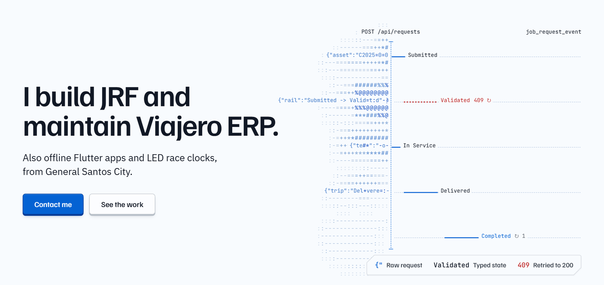

<a href="https://jiggy-portfolio.vercel.app">
  <picture>
    <source media="(prefers-color-scheme: dark)" srcset="assets/hero-dark.png">
    
  </picture>
</a>

# Jiggy B. Palconit

Software Developer at Viajero Motorcycles in General Santos City, Philippines. I build JRF, the company's job request system, and maintain its Java ERP. On the side I ship offline Flutter apps and LED race clocks.

**[Portfolio](https://jiggy-portfolio.vercel.app)** &nbsp;/&nbsp; **[Resume (PDF)](https://jiggy-portfolio.vercel.app/resume.pdf)** &nbsp;/&nbsp; **[jigspals025@gmail.com](mailto:jigspals025@gmail.com)**

## At Viajero Motorcycles, since February 2026

I keep established Java 7/8 Swing modules running for a multi-branch dealership and build new services beside them in Spring Boot.

- **JRF**, a job request workflow in Spring Boot (Java 17) that reads and writes the legacy ERP database. Requests move from Submitted to Completed, and `@Version` optimistic locking means two branches updating the same request cannot overwrite each other.
- **Apr 2026:** Bioclock actions, attendance logs and Swing document limiters.
- **Jun 2026:** an accounting bridge between the FACC and ACC modules, with report caching and payroll queues.
- **Aug 2026:** inventory forecasting, reorder-quantity formulas and QR asset labels.
- **Oct 2026:** cross-branch transfer guards and the JRF bridge into the ERP.

## Systems I've shipped

| System | What it does | Built with | Links |
| :--- | :--- | :--- | :--- |
| **Espasyo** | Offline Android ledger for a box-rental shop: vacant boxes, sales per box, seller balances and payouts, local and Google Drive backups | Flutter, Riverpod, Drift (SQLite) | [Code](https://github.com/jiggy025/rent-a-box-sys) |
| **Race Clock** | Race timer where the operator screen drives the stage LED wall, used at a live race in GenSan | TypeScript, Vite, PWA | [Live](https://race-clock-ten.vercel.app) |
| **MIS Calendar** | Field-visit scheduler whose database posts a 07:30 summary and same-day alerts to the team's Viber channel | Supabase Postgres, pg_cron, pg_net | [Live](https://codexus-calendar.netlify.app) |
| **JRF pitch film** | A motion film that walks through the JRF workflow | Remotion, React | [Watch](https://jrf-pitch.vercel.app) |
| **Langga Loan Tracker** | Mobile ledger for loans and installments | React Native, Expo, Reanimated | [Case study](https://jiggy-portfolio.vercel.app/#work) |

Each one is shown working, screen beside source, on the **[portfolio](https://jiggy-portfolio.vercel.app)**.

## What I work in

**Backend:** Java 7, 8, 17 and 21, Spring Boot, Swing, Hibernate/JPA, JasperReports 
**Mobile:** Flutter and Dart, React Native with Expo 
**Web:** TypeScript, Vite, Remotion 
**Data:** MySQL, PostgreSQL (Supabase), SQLite

## Get in touch

Open to engineering roles in General Santos City and remote (UTC+8).
Email **[jigspals025@gmail.com](mailto:jigspals025@gmail.com)** or see the work at **[jiggy-portfolio.vercel.app](https://jiggy-portfolio.vercel.app)**.
