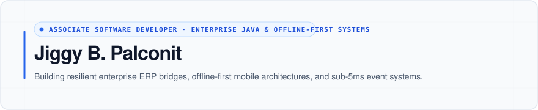

<div align="center">



<br/>

**[Portfolio Website](https://jiggy-portfolio.vercel.app)** &nbsp;•&nbsp; **[Resume (PDF)](https://jiggy-portfolio.vercel.app/resume.pdf)** &nbsp;•&nbsp; **[Get in Touch](mailto:jigspals025@gmail.com)**

<br/>

</div>

### Engineering Focus & Architecture

<p align="center">
  
  
  
</p>

---

### Production Engineering at Viajero Motorcycles Inc.

*Software Developer &bull; Feb 2026 – Present &bull; General Santos City, Philippines*

I maintain multi-branch enterprise ERP modules and engineer greenfield microservices bridging into legacy infrastructure with zero production regressions:

- **Greenfield JRF Microservice:** Built a standalone Job Request Form service in **Java 17 (Spring Boot 3.3)** bridging directly into a legacy Java 7/8 ERP database. Implemented optimistic concurrency controls (`@Version`) to guarantee zero write collisions across concurrent branch operations.
- **EDT Freeze Elimination:** Eliminated legacy Swing transaction and reporting freezes by enforcing strict `AutoCloseable` session lifecycles, background worker isolation, and optimized indexed SQL execution.
- **Algorithmic Inventory Engine (ROQ):** Developed automated reorder quantity calculation (`AMC × [ABC - SM]`) with day-anchored rolling windows across branch dealerships, systematically reducing stockout hazards.
- **Multi-Branch Concurrency Guards:** Engineered out-of-stock guard restrictions and transactional locks for cross-store transfers (`Viajero ↔ Jicjam`), stopping multi-store race conditions.
- **FACC ↔ ACC Accounting Bridge:** Designed a bidirectional inter-module accounting adapter with in-memory caching (`HashMap`), locked payroll queues, and reusable transaction components.

---

### Shipped Systems & Core Work

| System | Role & Architecture | Status & Links |
| :--- | :--- | :--- |
| **Espasyo (Rent-a-Box Ledger)** | **Offline-First Retail POS & Ledger:** Flutter mobile application built with SQLite and BLoC architecture. Features automated seller payout reconciliation, rental unit audits, and 53 passing automated tests. | [](https://github.com/jiggy025/rent-a-box-sys) |
| **Race Clock LED Wall PWA** | **Sub-5ms Timing Controller:** Real-time dual-screen PWA syncing director controls to live stage LED walls with under 5ms latency via high-frequency `localStorage` event bus and Screen WakeLock API. | [](https://race-clock-ten.vercel.app/) &nbsp; `Private System` |
| **MIS Operations Calendar** | **Automated Dispatch Scheduler:** Enterprise operations scheduling engine powered by Supabase PostgreSQL. Dispatches automated daily 07:30 cron briefings (`pg_cron`) directly to corporate Viber channels. | [](https://codexus-calendar.netlify.app) &nbsp; `Private System` |
| **Langga Loan Tracker** | **Financial Amortization Ledger:** React Native & Expo mobile ledger featuring fluid 60 FPS Reanimated spring interactions and zero-latency local state persistence. | [](https://jiggy-portfolio.vercel.app/#work) &nbsp; `Internal System` |

---

### Technical Arsenal

```
Backend & Enterprise  ──  Java (17 / 21 / 8), Spring Boot 3.3, Hibernate/JPA, JDBC, JasperReports, Java RMI, Java Swing
Mobile & Frontend     ──  Flutter, Dart, SQLite, BLoC Architecture, React Native (Expo), TypeScript, Vite, PWA
Databases & Cloud     ──  PostgreSQL, MySQL, SQLite, Supabase (pg_cron, Edge Functions)
Systems Engineering   ──  Optimistic Concurrency Control, EDT Thread Isolation, Event-Driven Sync, Local-First Architecture
```

---

<div align="center">

📍 **General Santos City, Philippines** &bull; [jigspals025@gmail.com](mailto:jigspals025@gmail.com) &bull; [jiggy-portfolio.vercel.app](https://jiggy-portfolio.vercel.app)

</div>
